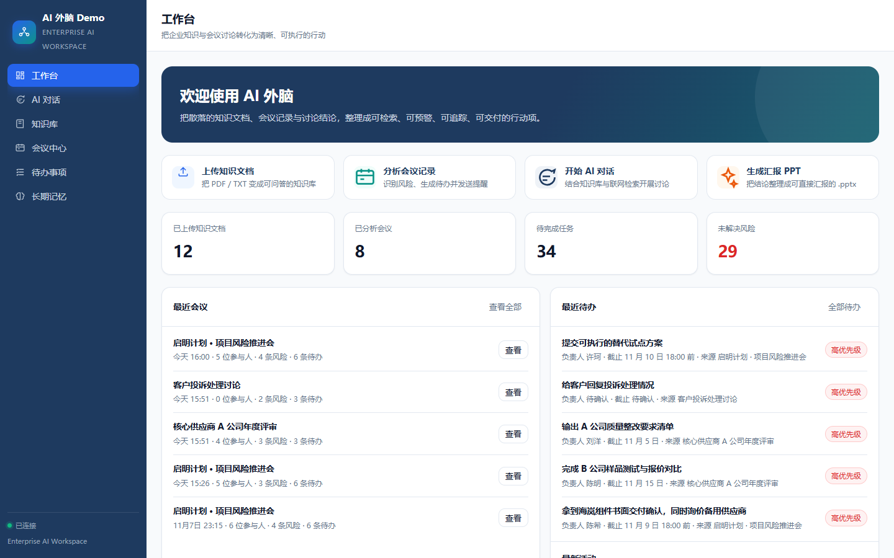
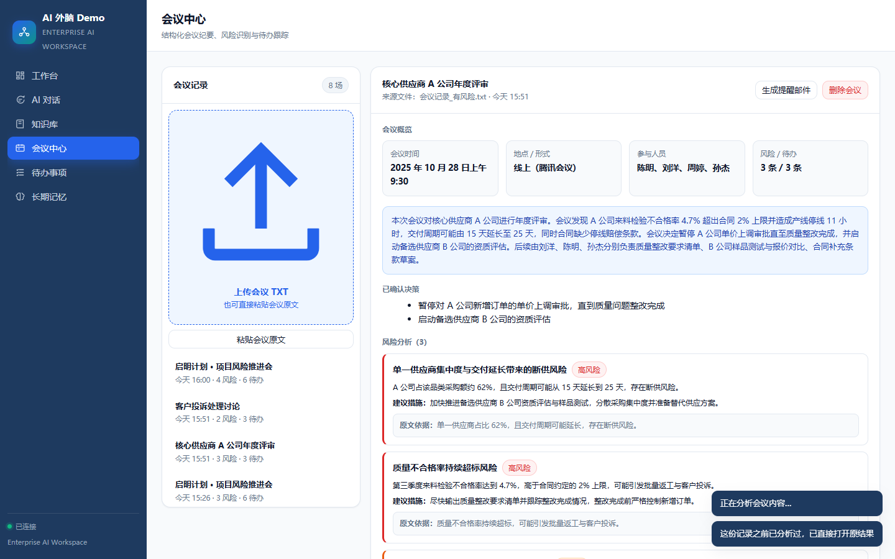
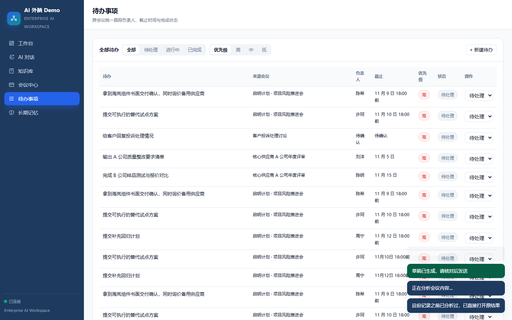
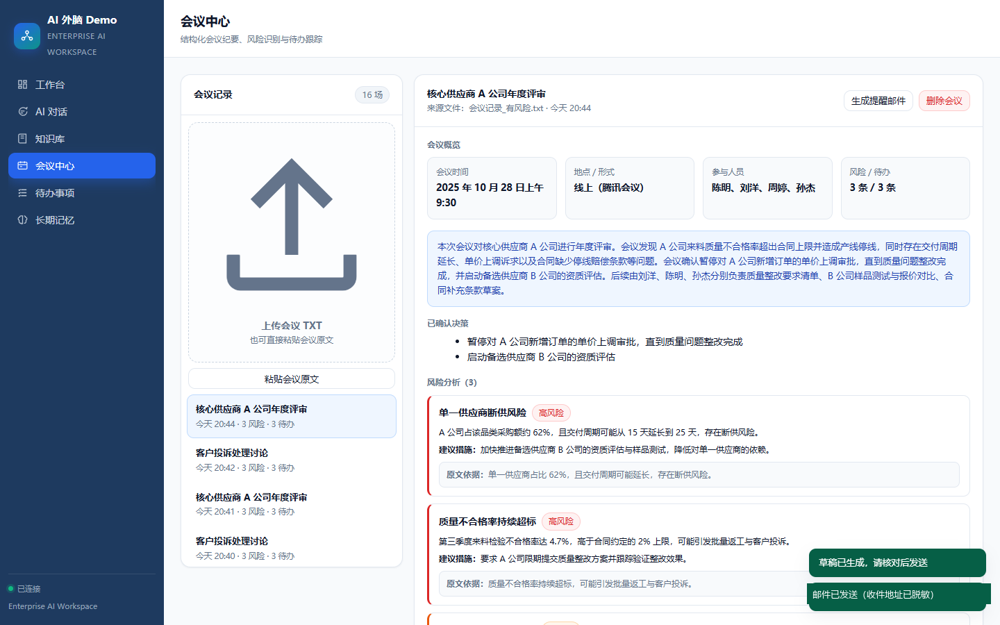
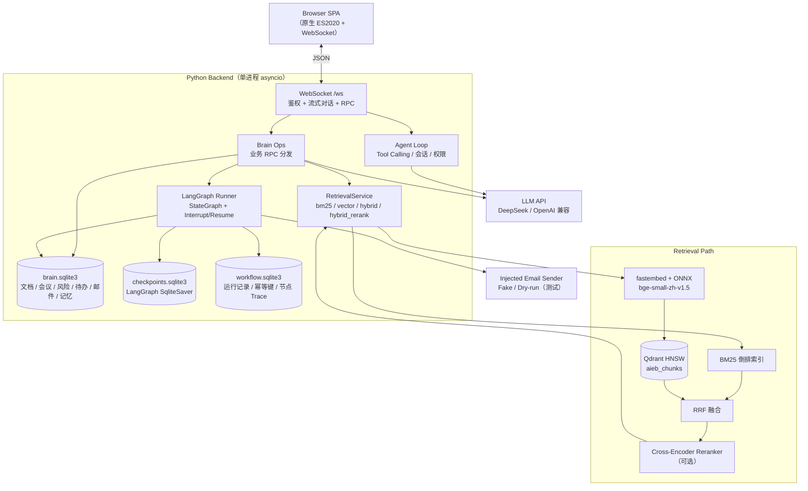
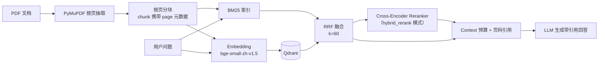
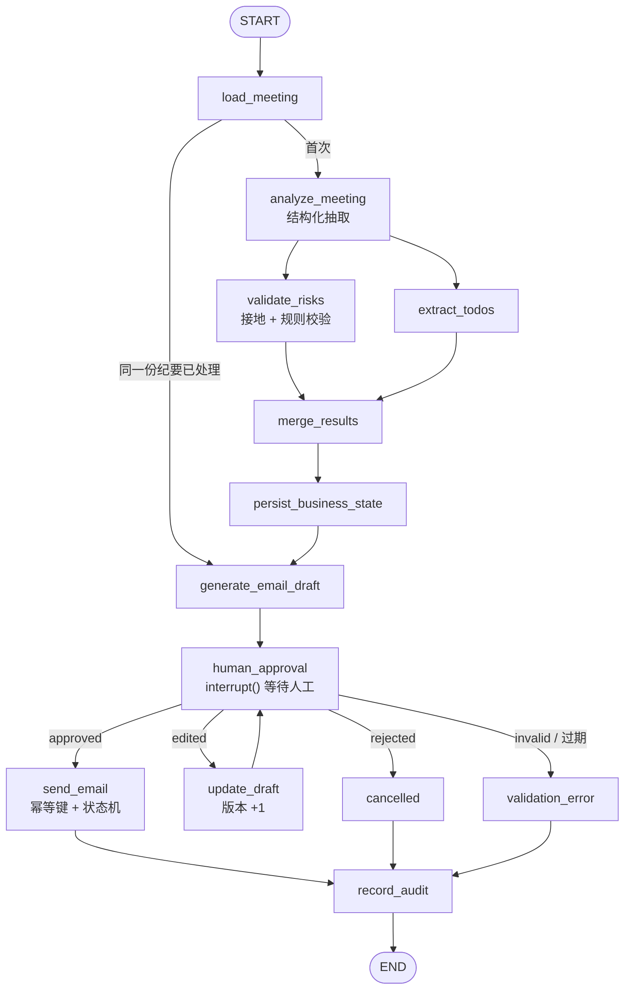
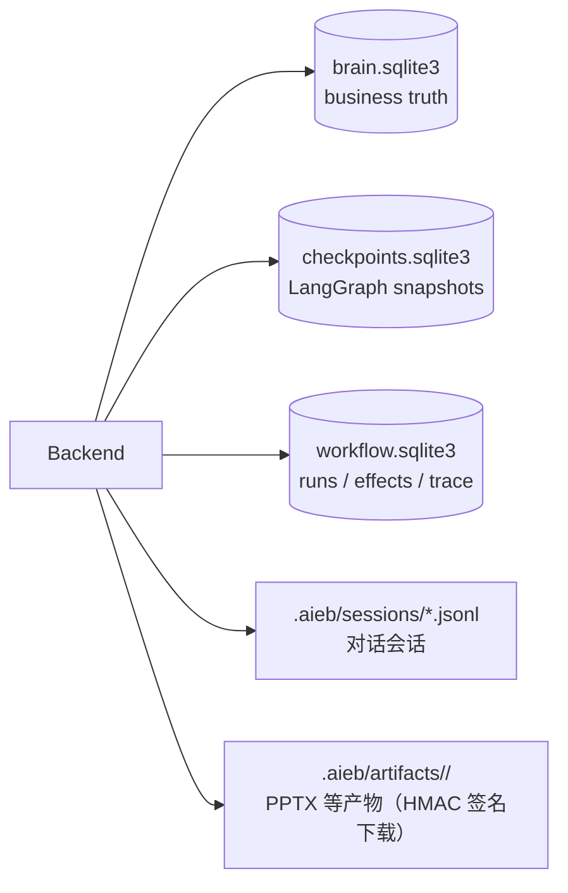

# AI External Brain

**Hybrid RAG & LangGraph-Powered AI Agent System**

> An AI Agent platform powered by Hybrid RAG and LangGraph for knowledge retrieval, meeting analysis,
> human-in-the-loop workflows, and reliable task execution.

**AI External Brain** 把「企业知识库问答 + 会议结构化分析 + 人工审批工作流 + 可复现评测」串成一条完整链路。
文档回答必须带页码引用；会议风险必须给原文依据；有副作用的动作必须由人确认。

`Python 3.11+` · `LangGraph 1.2.20` · `Qdrant 1.20.0` · 中文文档为主，术语保留英文

---

## 目录

- [1. 项目简介](#1-项目简介)
- [2. 核心特性](#2-核心特性)
- [3. 系统架构](#3-系统架构)
- [4. Hybrid RAG 技术实现](#4-hybrid-rag-技术实现)
- [5. LangGraph 工作流](#5-langgraph-工作流)
- [6. 性能与评测](#6-性能与评测)
- [7. Quick Start](#7-quick-start)
- [8. Docker（可选，尚未验证）](#8-docker可选尚未验证)
- [9. 测试](#9-测试)
- [10. 仓库结构](#10-仓库结构)
- [11. 已知限制](#11-已知限制)
- [12. 代码构成、许可与致谢](#12-代码构成许可与致谢)

---

## 1. 项目简介

企业里的 AI 应用真正难的不是「能聊天」，而是三件事：

1. **找得到**：制度与历史文档里的答案，要能定位到具体文件的第几页；
2. **传得下去**：会议开完后，风险、决策和待办要结构化落地，而不是留在录音里；
3. **说得清**：不确定时必须说「不确定」，有副作用的动作必须由人确认。

本项目围绕这三点实现了一个可本地运行、可评测、可追溯的 AI Agent 系统：

- **Hybrid RAG**：BM25 关键词检索 + Embedding / Qdrant 向量检索 + RRF 融合，可选 Cross-Encoder Reranker；
- **LangGraph 工作流**：`StateGraph` 编排会议分析、风险校验、待办抽取、邮件草稿与人工审批，SQLite Checkpoint 支持跨进程恢复；
- **Agent 执行系统**：DeepSeek（OpenAI 兼容协议）调用、Tool Calling、SQLite 长期记忆、WebSocket / Web UI、PPTX 生成、节点级 Trace；
- **工程验证**：pytest 回归、RAG Benchmark、真实 LLM 工作流评测、故障注入、浏览器 E2E。

> **项目定位**：这是一个面向单用户受控环境的工程实现与评测项目，不是已经完成企业级加固的商业产品。
> Docker 配置已提供，但**尚未在真实容器中完成构建与运行验证**。

---

## 2. 核心特性

| 能力 | 实现要点 | 状态 |
|---|---|---|
| **Hybrid RAG** | BM25（字符 n-gram 倒排）+ Embedding（fastembed / ONNX）+ Qdrant HNSW + RRF（k=60），可选 Cross-Encoder Reranker | 已实现，可配置启用 |
| **Document QA** | PDF 按页解析 → 分块 → 检索 → 带「文件名 · 第 N 页」引用回答；检索为空时明确说明 | 已实现 |
| **Context Budget** | `legacy`（6000 字符早停）与 `budgeted`（按 token 分配，默认上限 1800）两种模式 | 已实现 |
| **LangGraph Workflow** | `StateGraph`、并行节点、条件路由、fan-in、节点级 Trace | 已实现 |
| **Human-in-the-loop** | `interrupt()` / `Command(resume=...)`；审批绑定草稿版本，旧版本确认会被拒绝 | 已实现 |
| **SQLite Checkpoint** | `SqliteSaver` 每个 super-step 落盘，`thread_id` 稳定，可跨进程恢复 | 已实现 |
| **幂等副作用** | 发送前写 effect key（workflow + action + object + version）；`executing/uncertain` 不自动重发 | 已实现 |
| **Agent Tool Execution** | 工具注册表、权限规则、工具路由；知识库 / 会议 / 待办 / 邮件 / PPT 工具 | 已实现 |
| **Persistent Memory** | 人物 / 时间 / 地点 / 主题 / 决策 / 待办结构化写入 SQLite，跨会话召回 | 已实现 |
| **Automated Evaluation** | 冻结留出集检索评测、真实 LLM 工作流评测、故障注入、浏览器 E2E | 已实现，见 [§6](#6-性能与评测) |

**防编造的约束在服务端强制**：负责人 / 截止时间 / 时间 / 地点必须能在原文中找到，否则置空并标记「待确认」；
风险依据必须是原文片段；知识库检索不到时明确回答「没有相关内容」。

### 界面预览

| 工作台 | 会议分析（风险 + 原文依据） |
|---|---|
|  |  |

| 待办追踪 | 邮件审批（收件地址已脱敏） |
|---|---|
|  |  |

> 截图来自本地运行的真实界面，会议与文档内容均为 `samples/` 中的虚构演示数据；邮件地址已在生成时脱敏。

---

## 3. 系统架构

### 3.1 总体架构



### 3.2 RAG 路径



### 3.3 LangGraph 路径



> 工作流测试中的邮件发送通过注入的 sender 完成（Fake SMTP / dry-run）。项目**不声称**自动化测试会发送真实邮件。

### 3.4 持久化路径



| 数据 | 位置 | 说明 |
|---|---|---|
| 业务数据（文档 / 会议 / 风险 / 待办 / 邮件 / 记忆） | `<cwd>/.aieb/brain/brain.sqlite3` | 唯一真源（WAL） |
| LangGraph Checkpoint | `<cwd>/.aieb/workflow/checkpoints.sqlite3` | 每个 super-step 一份快照 |
| 工作流审计与幂等键 | `<cwd>/.aieb/workflow/workflow.sqlite3` | 节点级 Trace、`begin_effect` 记录 |
| 会话 | `<cwd>/.aieb/sessions/*.jsonl` | 前端会话历史 |
| 产物 | `<cwd>/.aieb/artifacts/` | 下载走 HMAC 签名 URL |

> `.aieb/` 是本地运行时目录，已在 `.gitignore` 中忽略，**不要提交**。

---

## 4. Hybrid RAG 技术实现

### 4.1 三种模式与一条默认路径

`AIEB_RETRIEVAL_MODE` 支持四种取值：

| 模式 | 召回 | 融合 | 重排 |
|---|---|---|---|
| `bm25`（**默认**） | BM25 | — | — |
| `vector` | Embedding + Qdrant | — | — |
| `hybrid` | BM25 + Qdrant | RRF | — |
| `hybrid_rerank` | BM25 + Qdrant | RRF | Cross-Encoder |

**Hybrid RAG 不是另一个独立于 BM25 的系统**，而是把 BM25 与向量检索的结果用 RRF 融合。
默认模式仍是 `bm25`，因此在没有 Qdrant / 模型缓存的环境中，系统行为与引入混合检索之前一致。

### 4.2 各组件的作用

- **BM25**：中文按字符 n-gram 建倒排索引。优势是精确匹配、可解释、延迟低，页码定位准；弱点是同义改写召回差。
- **Embedding + Qdrant**：`BAAI/bge-small-zh-v1.5`（ONNX Runtime，不依赖 torch）生成向量，写入 Qdrant HNSW。优势是语义召回与长尾覆盖。
- **RRF 融合**：只使用名次，不使用不同检索器的原始分数，避免分数尺度不一致。实现为
  $score(d)=\sum_{r \in R}\frac{1}{k+\mathrm{rank}_r(d)}$，默认 $k=60$。
- **Reranker（可选）**：Cross-Encoder 对 query–passage 成对打分，把「找得到」提升为「排得前」，代价是额外延迟。

### 4.3 降级语义：不静默失败

- Qdrant 不可用 → `RetrievalResult.degraded=True`，`degraded_reason` 写明原因，界面如实展示；
- Reranker 超时 / 失败 → 退回融合结果，`rerank.degraded_reason` 记录原因；
- 依赖缺失 → 在真正调用时抛出可读错误，而不是 import 阶段炸掉整个应用。

### 4.4 Context 预算与引用

- `AIEB_CONTEXT_BUDGET=legacy`：按 6000 字符早停（改造前行为）；
- `AIEB_CONTEXT_BUDGET=budgeted`：按 token 分配预算，默认 `AIEB_CONTEXT_MAX_TOKENS=1800`，中文按 1.74 字符/token 估算；
- 分块保留页码元数据，命中块即命中页，回答只引用真实命中的页码；检索为空时明确说明「没有相关内容」。

### 4.5 为什么保留纯 BM25

在冻结留出集上，BM25 的 R@1（0.532）与 MRR@10（0.691）**高于** hybrid（0.389 / 0.600），
且延迟只有 0.6 ms。Hybrid 的收益集中在 R@10 与「全证据召回」。
因此项目**没有**把 hybrid 设为默认，也没有声称 hybrid 在所有指标上都更好。详见 [§6](#6-性能与评测)。

---

## 5. LangGraph 工作流

### 5.1 拓扑与编排能力

工作流定义在 `aieb/workflow/graph.py`，与上面的 [§3.3](#33-langgraph-路径) 图一致：

- **StateGraph**：`WorkflowState` 只保存必要 ID 与结构化摘要，不把会议原文塞进 Checkpoint；
- **并行节点**：`analyze_meeting` 之后 `validate_risks` 与 `extract_todos` 并行执行，`merge_results` 做 fan-in；
- **条件路由**：`load_meeting` 后按是否已处理分流；`human_approval` 后按 `approved / edited / rejected / invalid` 四路路由；
- **审批绑定版本**：`update_draft` 会把草稿版本 +1 并回到审批；用旧版本确认会被拒绝。

### 5.2 Checkpoint 与跨进程恢复

- `SqliteSaver` 把每个 super-step 的快照写入 `.aieb/workflow/checkpoints.sqlite3`；
- `thread_id` 与 `workflow_id` 一一对应，进程重启后 `get_state()` 可读回并继续；
- 业务真相仍在 `brain.sqlite3`，Checkpoint 只用于执行恢复，删掉 Checkpoint 不会丢业务数据。

### 5.3 幂等与「不确定」语义

`send_email` 节点在真正发送前写入幂等键（workflow + action + object + version）：

- 已 `succeeded` → 直接返回完成，不重复发送；
- `executing / uncertain` → 标记为 `uncertain` 并停止自动重试，要求人工核实是否已投递；
- SMTP 异常 → 同样进入 `uncertain`，而不是假装成功或盲目重发。

### 5.4 Trace 与可观测性

节点执行、重试、中断、降级都会写入 `workflow.sqlite3` 的 `workflow_events`，前端工作流面板展示的状态来自后端 Checkpoint，
不是前端动画。样例见 [`docs/LANGGRAPH_TRACE_SAMPLE.md`](docs/LANGGRAPH_TRACE_SAMPLE.md)。

### 5.5 邮件测试说明

自动化测试与故障注入使用 **Fake SMTP / dry-run sender**，不会真的投递邮件；
`tests/conftest.py` 在整个 pytest 会话中摘除 SMTP 凭证并强制 `AIEB_EMAIL_DRY_RUN=1`。
真实 SMTP 投递只在显式手动脚本中发生，不属于本文档给出的默认测试流程。

---

## 6. 性能与评测

> 所有数字均来自仓库内已有的评测报告与结果文件，未为本文档重新调参或修改历史结果。
> 复现命令见 [`docs/HYBRID_RAG_BENCHMARK.md`](docs/HYBRID_RAG_BENCHMARK.md)、[`docs/LANGGRAPH_LIVE_BENCHMARK.md`](docs/LANGGRAPH_LIVE_BENCHMARK.md)。

### 6.1 RAG 检索质量（冻结留出集）

- 数据集：**120 份新 PDF / 600 页 / 320 道问题**（314 可答 + 6 无答案负例）；
- 该留出集带 `FREEZE.json` 与 sha256 校验，`used_for_tuning=false`，运行前会校验哈希；
- 检索层分母为 314（负例不计入 Recall）。

| 模式 | R@1 | R@5 | R@10 | MRR@10 | 全证据@10 | P50 |
|---|---|---|---|---|---|---|
| `bm25` | **0.532** | 0.723 | 0.838 | **0.691** | 0.790 | **0.6 ms** |
| `vector` | 0.221 | 0.629 | 0.798 | 0.445 | 0.780 | 16.8 ms |
| `hybrid` | 0.389 | 0.721 | **0.887** | 0.600 | **0.876** | 17.0 ms |
| `hybrid_rerank` | 0.521 | **0.734** | **0.887** | **0.692** | **0.876** | 543 ms |

**如何正确解读**：

- Hybrid 的收益在长尾召回：R@10 从 0.838 → 0.887（+4.9 pt），全证据@10 从 0.790 → 0.876（+8.6 pt）；
- **MRR / R@1 并未提升**：BM25 的 top-1 排序仍最强，Reranker 只能把 MRR 拉回与 BM25 持平（0.692 vs 0.691）；
- 检索层 95% 置信区间半宽约 ±5.5 pt，小差距不应被当作确定收益。

### 6.2 BM25 性能优化（75,000 chunk 规模）

| 指标 | 优化前 | 优化后 |
|---|---|---|
| BM25 查询 P50 | 605 ms | **17 ms**（约 35.6× 加速） |
| 向量检索 P50 | 24 ms | 19 ms（HNSW 参数调整） |
| Hybrid P50 | 619 ms | 42.5 ms |

优化手段：倒排索引 + idf 外提 + numpy 向量化，并有 `tests/test_bm25_equivalence.py` 做逐位等价校验。

### 6.3 LangGraph 工作流（真实 LLM）

- 数据集：**25 场会议**（作者编写 + 程序校验的合成场景），真实 DeepSeek 调用 50 次；
- 平均输入 / 输出 tokens：25,559 / 30,309。

| 指标 | 结果 |
|---|---|
| Workflow Completion Rate | **25/25** |
| Task Success Rate | **25/25** |
| 风险识别 P / R / F1（micro） | 0.8539 / 0.8172 / **0.8352** |
| 待办提取 P / R / F1（micro） | 0.9383 / 0.9870 / **0.9620** |
| Duplicate Side-Effect Count | **0** |
| 端到端 P50 / P95 | 7,876 ms / 12,054 ms |

**注意**：这是 25 场合成会议的评测结果，样本量小、置信区间宽，不能当作真实企业生产准确率；
工作流完成率也不等于风险识别准确率。

### 6.4 故障注入

`python -m benchmarks.workflow.fault_injection` 覆盖真实进程崩溃恢复、并发审批、LLM 超时、非法 JSON、
SQLite 锁冲突、Checkpoint 损坏、SMTP 异常、旧版本审批等场景：

> **19 个场景，通过 19，重复副作用 0**（本次发布准备中重新执行确认）

### 6.5 浏览器与回归测试

| 检查 | 结果 | 证据 |
|---|---|---|
| pytest 全量回归 | **1476 passed / 2 failed / 12 skipped** | 本次执行（见 [§9](#9-测试)） |
| 产品主流程浏览器 E2E | **33/33 步通过**（Playwright + 本机 Chrome） | [`docs/browser_e2e_report.md`](docs/browser_e2e_report.md) |
| Hybrid 四模式 + 降级路径浏览器 E2E | 5 组脚本、37 项检查全部为 true | `benchmarks/results/hybrid_rag/e2e_browser_*.json` |
| 故障注入 | 19/19 通过 | [`docs/LANGGRAPH_FAULT_INJECTION_REPORT.md`](docs/LANGGRAPH_FAULT_INJECTION_REPORT.md) |

2 项失败均为 Windows 环境相关：`tests/test_hooks.py` 使用 Unix `sleep`，`tests/test_bash_encoding.py` 的本地代码页用例。
另有 `tests/test_agent.py::test_stop_cancel` 为时序敏感用例（依赖 0.15s 内是否已产出事件），
单独运行时可能失败，全量运行中也出现过一次；它与本次发布整理无关。

---

## 7. Quick Start

### 7.1 运行要求

- Python **3.11+**（本机验证环境为 3.14.2；Docker 镜像使用 3.12）
- 可选：Qdrant（仅 `vector / hybrid / hybrid_rerank` 模式需要）
- 可选：LangGraph（工作流功能需要）
- 一个 OpenAI 兼容或 Anthropic 协议的模型 API Key（默认 DeepSeek）

### 7.2 安装

```powershell
# 基础能力（BM25 检索 / 会议分析 / 待办 / 邮件 / PPT）
python -m venv .venv
.\.venv\Scripts\python.exe -m pip install -e .
```

```bash
# Linux / macOS
python -m venv .venv
source .venv/bin/activate
pip install -e .
```

按需安装可选依赖：

```powershell
# Hybrid RAG（qdrant-client + fastembed + onnxruntime）
.\.venv\Scripts\python.exe -m pip install -e ".[hybrid]"

# LangGraph 工作流（锁定版本见 requirements-langgraph.txt）
.\.venv\Scripts\python.exe -m pip install -r requirements-langgraph.txt
```

### 7.3 配置

```powershell
Copy-Item .aieb\config.yaml.example .aieb\config.yaml
$env:DEEPSEEK_API_KEY = "<your-api-key>"
```

配置文件里使用环境变量占位符，**不要把密钥写进文件**：

```yaml
providers:
  - name: deepseek-flash
    protocol: openai-compat
    base_url: https://api.deepseek.com
    model: deepseek-chat
    api_key: "${DEEPSEEK_API_KEY}"
permission_mode: default
remote:
  host: 127.0.0.1
  port: 18888
```

可选环境变量（完整示例见 `.env.example`）：

| 变量 | 作用 |
|---|---|
| `AIEB_RETRIEVAL_MODE` | `bm25`（默认）/ `vector` / `hybrid` / `hybrid_rerank` |
| `AIEB_QDRANT_URL` | Qdrant 地址，默认 `http://127.0.0.1:6333` |
| `AIEB_EMBEDDING_MODEL` | 默认 `BAAI/bge-small-zh-v1.5` |
| `AIEB_CONTEXT_BUDGET` | `legacy` / `budgeted` |
| `AIEB_EMAIL_DRY_RUN` | `1` 时拦截真实投递（测试默认） |
| `AIEB_REMOTE_TOKEN` | 绑定非本机地址时必需 |

### 7.4 启动

```powershell
.\.venv\Scripts\python.exe -m aieb.brain.cli --port 18888
# 或安装后直接： aieb --port 18888
```

浏览器打开 **http://127.0.0.1:18888/**，默认进入工作台。
首次启动会自动创建 `.aieb/` 运行时目录（已忽略提交）。未配置密钥时，程序会给出中文提示并以非 0 退出码结束。

启用 Hybrid RAG 时，需要先启动 Qdrant：

```powershell
docker run -p 6333:6333 qdrant/qdrant:v1.20.0
$env:AIEB_RETRIEVAL_MODE = "hybrid"
```

### 7.5 体验路径

1. **PDF 知识问答**：知识库 → 上传 `samples/demo_company_background.pdf` → 提问
   「单价上调超过 8% 需要谁审批？」→ 回答带 `[来源：demo_company_background.pdf · 第 2 页]`。
2. **会议分析**：会议中心 → 上传 `samples/demo_meeting_risk.txt`（也支持 `.md` / `.docx` / `.pdf`）→ 得到风险与待办，每条带原文依据。
3. **人工审批工作流**：会议中心 → 「用工作流处理（含邮件审批）」→ 填写会议记录 → 启动工作流 →
   在审批卡片中确认 / 修改 / 取消。邮件发送使用注入的 sender，未配置 SMTP 时不会真实投递。
4. **长期记忆**：新建对话，询问上一次会议的时间、参与人与决策，验证跨会话召回。

> `samples/` 下的企业与会议资料均为虚构演示数据，与任何真实企业无关。

---

## 8. Docker（可选，尚未验证）

> **Docker configuration is provided, but actual container deployment has not yet been verified.**
>
> 仓库已完成 Dockerfile / Compose 静态配置与宿主机「运行契约」测试（相同环境变量、`0.0.0.0` 绑定 + token、
> 独立数据目录、跨进程重启恢复）。但本机没有 Docker，`docker build` 与 `docker compose up` **未执行**，
> 因此不能声称容器部署成功。

```powershell
Copy-Item .env.example .env
# 在 .env 中填写 DEEPSEEK_API_KEY 与 AIEB_REMOTE_TOKEN（生成方式见文件注释）
docker compose up --build -d
# 浏览器打开 http://localhost:18888/#token=<与 .env 中的 AIEB_REMOTE_TOKEN 一致>
```

- 服务：`aieb`（Python 后端）+ `qdrant`（向量库）；
- 数据卷：`aieb_data`、`qdrant_storage`（`docker compose down -v` 会删除数据）；
- 健康检查：`GET /healthz`、`GET /readyz`；
- 详细说明与已知限制：[`docs/docker-deployment.md`](docs/docker-deployment.md)、
  [`docs/DOCKER_DEPLOYMENT_VALIDATION.md`](docs/DOCKER_DEPLOYMENT_VALIDATION.md)。

---

## 9. 测试

```powershell
# 1) 全量回归（不调用真实模型，不发真实邮件）
.\.venv\Scripts\python.exe -m pytest -q

# 2) RAG / 会议 / Agent 三套件评测（fixture 模式不调用模型）
.\.venv-langgraph\Scripts\python.exe -m benchmarks.run --suite all --mode fixture

# 3) LangGraph 工作流测试
.\.venv-langgraph\Scripts\python.exe -m pytest -q tests -k workflow

# 4) 故障注入（19 场景，使用 Fake SMTP）
.\.venv-langgraph\Scripts\python.exe -m benchmarks.workflow.fault_injection

# 5) 浏览器 E2E（需要 Playwright + 本机 Chrome）
.\.venv-langgraph\Scripts\python.exe scripts\browser_e2e.py --port 18889
```

> **API 费用提醒**：`benchmarks.run --mode live`、`benchmarks.workflow.live_benchmark` 会调用真实 LLM 并产生费用，
> 请显式设置 `--max-calls`（`benchmarks.run --max-calls` / `live_benchmark --max-calls`）后再运行。
> 普通 `pytest` 不需要 API Key，也不会发送真实邮件。

本次发布准备中实际执行的结果：

| 项目 | 结果 |
|---|---|
| `python -m pytest -q` | 1476 passed / 2 failed / 12 skipped（320.71s） |
| 副本全量复跑 | 1475 passed / 3 failed / 12 skipped（多出 `test_stop_cancel` 时序抖动） |
| `pytest -q tests -k workflow` | 65 passed / 1 skipped |
| `python -m benchmarks.workflow.fault_injection` | 19/19 通过，重复副作用 0 |
| `python scripts/audit_secrets.py` | 高置信度密钥 0，中置信度 5（均为变量名误报） |

---

## 10. 仓库结构

```text
AI-External-Brain/
├── aieb/                        # Python 包（CLI 入口 aieb）
│   ├── brain/                   # ★ 本项目新增的业务层
│   │   ├── knowledge.py         # PDF 解析 / 分块 / BM25 / 引用
│   │   ├── retrieval/           # Hybrid RAG：BM25 + Qdrant + RRF + Reranker
│   │   ├── meetings.py          # 会议结构化 + 防编造清洗
│   │   ├── store.py             # SQLite 业务数据层
│   │   ├── mailer.py            # SMTP（测试默认 dry-run）
│   │   ├── pptgen.py            # PPTX 生成
│   │   ├── service.py / ops.py  # 业务服务与 RPC 分发
│   │   └── ui/                  # 产品界面（HTML/CSS/JS，无构建步骤）
│   ├── workflow/                # ★ LangGraph 工作流
│   │   ├── graph.py             # StateGraph 拓扑
│   │   ├── nodes.py             # 节点实现（分析 / 校验 / 审批 / 发送）
│   │   ├── persistence.py       # 运行记录 / 幂等键 / Trace
│   │   └── checkpointer.py      # SqliteSaver
│   ├── agent.py / tools/        # 复用的 Agent Loop 与工具运行时
│   ├── memory/ sessions/        # 会话与长期记忆
│   └── remote.py                # WebSocket 服务与鉴权
├── tests/                       # pytest 回归（83 个 test_*.py）
├── benchmarks/
│   ├── datasets/                # 合成语料与问题集（含冻结留出集）
│   ├── results/                 # 历史评测原始结果
│   ├── workflow/                # 工作流评测 / 故障注入
│   └── run.py                   # 评测入口
├── scripts/                     # 冒烟 / E2E / 密钥扫描 / 演示数据生成
├── samples/                     # 虚构企业样例（PDF + 会议记录）
├── docs/                        # 架构、评测、部署与验证报告
├── docker/                      # entrypoint 与容器配置模板
├── Dockerfile / docker-compose.yml
├── .env.example                 # 无凭据的配置模板
└── pyproject.toml / requirements*.txt
```

> `.aieb/`、`.env`、虚拟环境、SQLite、模型缓存、`tools/qdrant/` 属于本地运行时或第三方二进制，**不在仓库中**。

---

## 11. 已知限制

1. **单用户受控环境**：没有多租户隔离与完整的 RBAC；不要直接暴露到公网。
2. **Docker 未实测**：只完成静态配置与宿主机契约测试，容器构建 / 启动 / 恢复均未验证。
3. **不保证跨外部邮件系统的严格 Exactly-Once**：只能保证本地幂等键与 `uncertain` 语义，SMTP 侧仍可能重复或丢失。
4. **评测规模有限**：留出集为 120 文档 / 320 题；工作流评测为 25 场合成会议，不能外推为生产准确率。
5. **模型能力依赖外部 API**：默认使用 DeepSeek；离线环境下只能使用 BM25 与规则层能力。
6. **扫描件无 OCR**：只提示「文本无法提取」。
7. **Windows 优先**：2 项回归失败与 Windows 代码页 / Unix 命令差异有关。
8. **依赖许可约束**：`PyMuPDF` 为 AGPL-3.0 / 商业双许可，闭源商业分发前需确认授权或替换解析库。

---

## 12. 代码构成、许可与致谢

### 12.1 代码构成

- **本项目实现**：`aieb/brain/` 下的知识库、Hybrid RAG、会议分析、待办、邮件、PPT、产品 UI 与业务 API；`aieb/workflow/` 下的 LangGraph 工作流。
- **沿用既有 Agent 运行时**：`aieb/` 其余模块（Agent Loop、Tool Calling、会话、记忆、WebSocket、权限等）。
  这部分**不是本项目从零实现**，项目内记录的上级框架名称为 `MewCode Agent`（见 `aieb/__init__.py` 的 `__upstream__` 常量）。
- 完整文件边界与署名要求见 [`docs/ATTRIBUTION.md`](docs/ATTRIBUTION.md)。

### 12.2 第三方组件

| 组件 | 用途 | 许可证 |
|---|---|---|
| `websockets` | WebSocket 服务 | BSD-3-Clause |
| `pydantic` | 结构化输出校验 | MIT |
| `python-pptx` | 生成 `.pptx` | MIT |
| `PyMuPDF` | PDF 文本与页码提取 | **AGPL-3.0 / 商业双许可** |
| `qdrant-client` / Qdrant | 向量检索 | Apache-2.0 |
| `fastembed` / `onnxruntime` | Embedding 与 Reranker 推理 | Apache-2.0 / MIT |
| `langgraph` / `langgraph-checkpoint-sqlite` | 工作流编排与 Checkpoint | MIT |
| `marked` / `DOMPurify`（CDN） | 前端 Markdown 渲染与消毒 | MIT / Apache-2.0 |

许可证以各组件官方发布为准；发布前请自行复核。

---

## 致谢

- 既有 Agent 运行时的作者与维护者；
- Qdrant、LangGraph、fastembed、PyMuPDF、python-pptx 等开源项目；
- 所有评测数据均为合成或虚构数据，不包含真实企业文档与个人信息。
