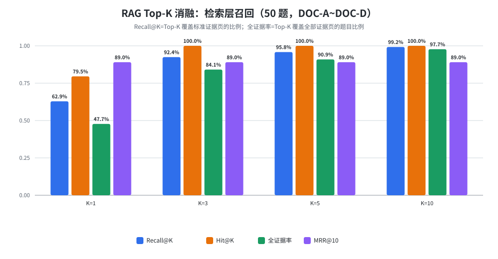
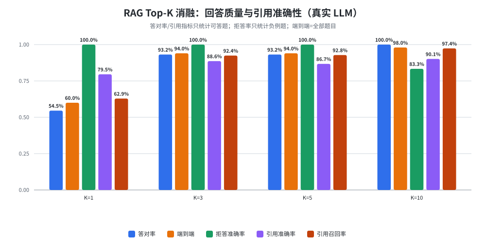
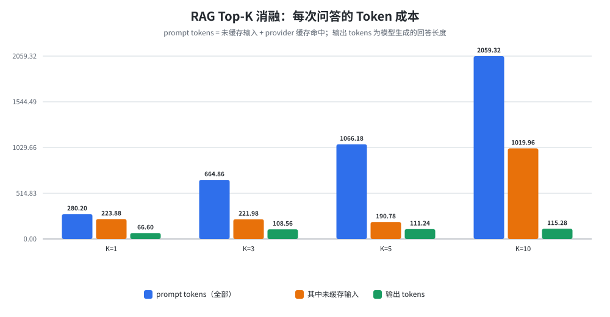
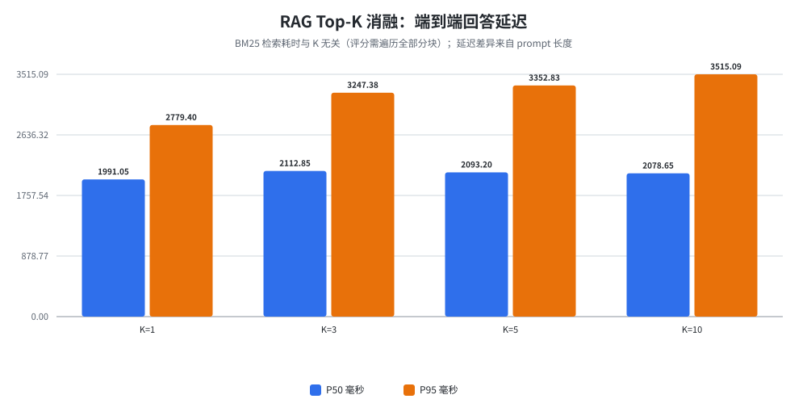
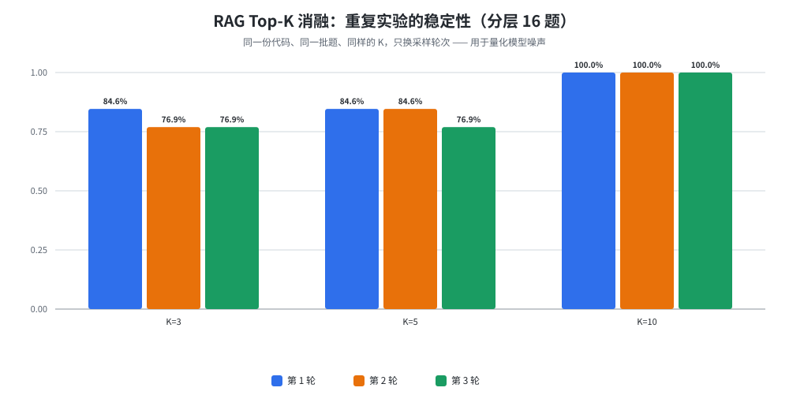
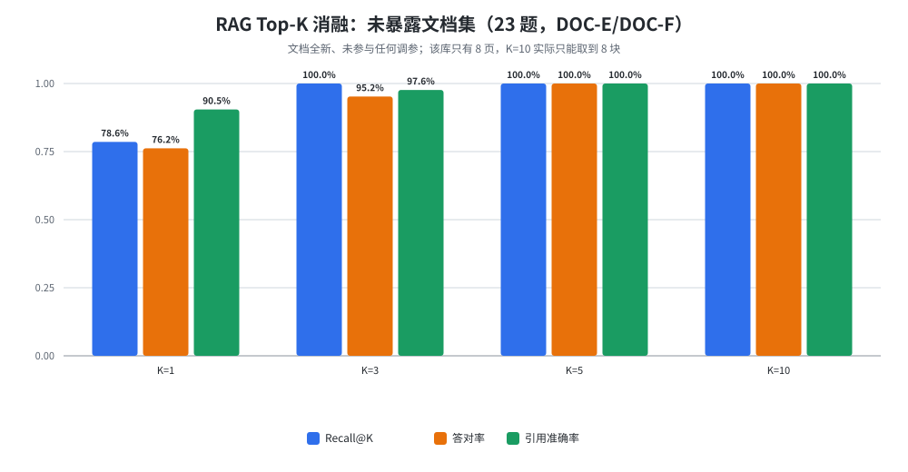

# RAG Top-K 消融实验报告

> 本报告回答一个问题：**生产环境里"检索 5 个片段"这个默认值，是被数据支持的选择，还是拍脑袋的默认？**
>
> 结论先说：**K=5 不是最优，但也没有被数据否定。** 在本次实验的数据上，K=1 明显不可用；K=3 与 K=5 在统计上不可区分；**K=10 的答对率高 6.8pt 并在 3 轮重复中全部复现**，代价是 prompt token 变成 1.93 倍。因此"Top-5 合理"只在"成本/质量均衡"这个意义上成立，在"质量最优"这个意义上不成立。
>
> 所有数字都来自 `benchmarks/results/topk/` 下的原始结果文件，表格由 `python -m benchmarks.ablations.report_topk` 机器生成（见 `docs/_topk_tables.md`），未做任何手工调参。

---

## 1. 实验目的与边界

**目的**

1. 把 Top-K 从"评测器里的一个 @K 数字"变成**真实的生产参数**，验证它对检索召回、回答质量、引用准确性、延迟与 Token 成本的实际影响。
2. 用数据判断生产默认值 K=5 是否合理；**不预设 K=5 最优**。

**边界（这些事本次没有做）**

* 没有修改标准答案、没有删题、没有为某道题写特判分支。
* 没有改动 `BM25Index` 的打分公式、分块参数（700/120）或 `ANSWER_SYSTEM` 提示词 —— 本次唯一的产品代码改动是一个 **token 统计 bug 修复**（见第 12 节），与检索行为无关。
* 没有触及正式运行目录 `.aieb/`：每次运行前后都做目录指纹比对，全部为"未改动"。
* 没有发任何真实邮件、没有联网渲染。

---

## 2. 实验环境与可复现性

| 项目 | 值 |
| --- | --- |
| 模型 | `deepseek-chat`（provider 协议 `openai-compat`） |
| Python | 3.14.2 / Windows |
| 隔离方式 | 每次运行在 `benchmarks/.work/<run_id>/workspaces/topk` 建独立 `.aieb`（独立 SQLite / 上传目录 / 索引） |
| 调用预算 | 全部运行都带 `--max-calls` 硬上限，实际用量见第 10 节 |
| 复现命令 | `python -m benchmarks.ablations.topk --mode live --dataset full --k 1,3,5,10 --max-calls 200` |
| 结果文件 | `benchmarks/results/topk/topk_*_{retrieval,qa}_{cases.csv,summary.json}` + `*_manifest.json` |
| 图表 | `python -m benchmarks.ablations.report_topk` → `benchmarks/reports/chart_topk_*.svg` |

**被测代码路径与生产完全一致**：`BrainService.upload`（真实 PDF 解析入库）→ `BM25Index.search(query, top_k=K)` → `knowledge.build_context(hits)` → `ANSWER_SYSTEM` + `llm.complete`。实验只做两件事：把 K 作为参数传进去；旁听 `StreamEnd` 读取真实 token 用量。

---

## 3. 先审计：K 到底控制什么

这一步是本次实验的前提。**"检索阶段 Top-K"和"最终传给大模型的上下文块数"不是同一个东西**，必须分开测量。

### 3.1 代码审计结论（逐条回答）

| 问题 | 结论 | 证据位置 |
| --- | --- | --- |
| 生产检索用的 Top-K 是多少 | **5** | `service.py` `answer(question, top_k=5)`、`search(top_k=5)`；`tools.py` `SearchKnowledgeParams.top_k = 5`；`ops.py:132` 硬编码 `top_k=5` |
| 由哪个参数/函数控制 | `BrainService.answer/search(top_k)` → `BM25Index.search(query, top_k)`；Agent 工具层再夹一层 `max(1, min(8, top_k))` | `knowledge.py:376`、`tools.py:42` |
| BM25 返回 Chunk 还是整页 | **分块（chunk）**。分块按页边界内切分，目标 700 字符、重叠 120 字符，同一块绝不跨页 | `knowledge.py` `chunk_pages` |
| 是否存在同页多分块 / 重复分块 | 同页多块**存在**（长页必然被拆）；重复分块**不存在**（重叠只保证窗口前进，不复制整块；检索层无去重逻辑，实测 `duplicate_chunk_texts = 0`） | 第 3.2 节实证 |
| 检索结果有无截断/过滤/去重 | `format_citations` 不截断不去重（返回全部 K 条）；`build_context` 按 **6000 字符**预算截断，单块取 `text[:1200]` | `knowledge.py:427` |
| LLM 实际收到几个 Chunk | `min(K, 预算允许的块数)`。本数据集块很短（平均 265.6 字符），K=10 时 10 块全部进入；**长分块场景下 K=10 只进 8 块** | 第 3.2、5.4 节 |
| 是否有最大上下文限制 | 有：`build_context(max_chars=6000)`。这是**产品侧预算**，与模型 context window 无关 | `knowledge.py:427` |
| Recall@5 是不是生产 K | **不是**。Recall@5 只是评测口径（评测器独立按"页集合"算 Recall@K）；生产 K 是参数默认值 5，从未被实验证明过最优 | `evaluators/rag.py` |
| Agent 会不会绕过检索直接回答 | **会**。`turn_hint_provider` 只注入"知识库有 N 份文档"的状态提示，模型可以自己决定不调用 `SearchKnowledge`；调用时 K 由模型传参（默认 5，上限 8） | `routing.py`、`remote.py`、`tools.py:42` |

### 3.2 用长页文档实证分块与预算行为

`python -m benchmarks.ablations.topk_audit`（不调用模型，纯检索）构造了一份 6 页、8196 字符的文档：

```json
{
  "document": { "pages": 6, "chars": 8196, "chunks": 12,
                "chunks_per_page": {"1":2,"2":2,"3":2,"4":2,"5":2,"6":2},
                "avg_chunk_chars": 683.0 },
  "retrieval": { "returned_chunks": 10, "distinct_pages": 6,
                 "duplicate_chunk_texts": 0, "max_chunks_same_page": 2 },
  "context_budget": { "max_chars": 6000, "retrieved_chunks": 10,
                      "blocks_in_prompt": 8, "dropped_chunks": 2,
                      "context_chars": 5682, "truncated": true,
                      "replica_matches": true }
}
```

由此得到三条硬结论：

1. **chunk ≠ page**：6 页被拆成 12 块，单页最多 2 块。
2. **不重复**：`duplicate_chunk_texts = 0`，重叠窗口没有制造重复内容。
3. **K 不等于进模型的块数**：检索到 10 块，但 6000 字符预算只放进去 **8 块**，2 块被丢弃。所以在"块接近 700 字符目标"的真实场景里，**把 K 从 5 调到 10，未必真的多给模型 5 块上下文**。

> 本实验用的评测文档每页都很短（20 块 / 20 页，平均 265.6 字符），所以 K=10 的 10 块全部进得去（平均上下文 3061 字符 < 6000）。这一点在解读 K=10 的收益时必须记住：**它是在"预算未被打满"的有利条件下取得的。**

---

## 4. 折中与取舍：Top-K 本质是什么

Top-K 是一个**召回率与上下文噪声之间的权衡**：

* K 太小 → 标准证据页根本没进上下文 → 模型只能回答"资料中未提及"（**假拒答**）。
* K 太大 → 无关片段混进来 → 模型被干扰、引用到错误页、prompt token 线性增长，还可能对负例问题强行作答（**假回答**）。

本实验的价值在于把这两条曲线的拐点用数据标出来，而不是引用经验值。

---

## 5. 实验设计

### 5.1 数据

| 集合 | 题目 | 文档 | 用途与**暴露状态** |
| --- | --- | --- | --- |
| `full` | 50 题（44 可答 + 6 负例），覆盖 9 种题型 | DOC-A ~ DOC-D（20 页） | 主实验。**已暴露**：Phase B 建库时人工校订过 gold 页，Phase C 也跑过多轮 |
| `full_stability` | 分层抽 16 题（13 可答 + 3 负例）× 3 轮 | 同上 | 噪声估计。刻意包含已知难例（RAG-012/029/031）与 K=10 出错的那道负例（RAG-035） |
| `unseen` | 23 题（21 可答 + 2 负例） | DOC-E / DOC-F（8 页，全新文档） | 泛化检验。文档未参与过任何调参，但题目在 Phase C 已跑过约 4 次 → **部分暴露** |

**必须如实说明**：这一次没有真正"一次都没看过"的干净测试集。所以本报告的措辞是"**当前样本下的推荐配置**"，而不是"已证明的最优配置"。

### 5.2 变量与对照

* 自变量：`K ∈ {1, 3, 5, 10}`
* 控制变量：同一批文档、同一批题、同一个模型、同一个 workspace 结构、同样的 `ANSWER_SYSTEM`、同样的分块参数。
* 唯一真正变化的量：**送进 prompt 的分块数量**（第 3 节已证明它确实发生了变化）。

### 5.3 指标口径（避免自欺）

| 指标 | 定义 | 为什么这样定义 |
| --- | --- | --- |
| Recall@K | Top-K 覆盖的 gold 页 / 全部 gold 页，按题平均 | 回答"证据齐不齐" |
| Hit@K | Top-K 至少有一个 gold 页的题目比例 | 只回答"有没有命中"，比 Recall 宽松，**两者必须同时看** |
| 全证据率@K | Recall@K = 1 的题目比例 | 多页/跨文档题能否一次答对的关键 |
| MRR@10 | 第一个 gold 页的倒数排名，**窗口固定为 10** | 不能用不同 K 算不同口径的 MRR 再互相比较 |
| 答对率 | 关键事实全部命中且无禁用内容（可答题） | 确定性规则打分，非 LLM 裁判 |
| 拒答准确率 | 负例题正确拒答的比例 | 只在负例题上算，不混进答对率 |
| 端到端 | 全部题目一次算对的比例 | 真实用户体验口径 |
| 引用准确率 / 召回率 | 从**回答正文**解析 `[来源：X · 第N页]`，与 gold 页比 | 不用接口返回的 `citations` 字段（那描述的是"检索到了什么"，不是"模型引用了什么"） |
| 依据度 | 回答里的带单位数字能否在上下文中找到 | 抓"凭空冒出来的数字" |
| Token | provider 回传的 `prompt_tokens`（= 未缓存输入 + 缓存命中）与 `completion_tokens` | **真实计量，不是按字符估算** |

### 5.4 判定规则（在看结果前定下）

1. `full` 集 44 道可答题，**1 道题 = 2.3pt**。差异 ≤ 1 道题 → 判"不可区分"，不当作结论。
2. 差异 > 1 道题时，必须在 3 轮重复中**至少 2 轮复现且方向一致**才算信号。
3. 满足 1、2 后，若质量打平，**按成本更低者推荐**（prompt token、P95 延迟）。

> 注：规则 1、2 是实验设计的一部分，但主实验先于稳定性实验执行。因此本报告中所有"K=3 与 K=5 不可区分"的判断都以稳定性实验（第 8 节）为准，而不是只看主实验的单轮数字。

---

## 6. 实验结果一：检索层

数据：`topk_full_retrieval_summary.json`，50 题（其中 6 条负例不计入 Recall 分母）。

| K | Recall@K | Hit@K | 全证据率 | MRR@10 | 平均进 prompt 块数 | 平均上下文字符 | 被 6000 字符预算截断题数 |
| --- | --- | --- | --- | --- | --- | --- | --- |
| 1 | 62.9% | 79.5% | 47.7% | 0.890 | 1.0 | 304 | 0 |
| 3 | 92.4% | 100.0% | 84.1% | 0.890 | 3.0 | 903 | 0 |
| 5 | 95.8% | 100.0% | 90.9% | 0.890 | 5.0 | 1524 | 0 |
| 10 | 99.2% | 100.0% | 97.7% | 0.890 | 10.0 | 3061 | 0 |



读出四件事：

1. **K=1 只能覆盖 62.9% 的证据页**：一半以上的题注定答不全。这是后面答对率暴跌的直接原因。
2. **Hit@K 在 K=3 就已经 100%**，但 **Recall@K 只有 92.4%** —— 这个差值（7.6pt）就是"命中了一个证据页但没凑齐全部证据页"的题目，正是 `multi_page` / `cross_document` 两类。
3. **全证据率是随 K 单调上升的**：47.7% → 84.1% → 90.9% → 97.7%。K=5→K=10 还有 6.8pt 的提升，说明**当前 K=5 并没有把证据覆盖做到饱和**。
4. **MRR@10 恒为 0.890**：排序完全由 BM25 决定，与 K 无关（本次实验只切窗口，不改排序）。这也从侧面证明：**K 的作用是"多看几位"，不是"排得更好"**。

**检索延迟与 K 无关**（四次都是 0.4ms）：BM25 要对全部分块打分，最后才截取 Top-K。所以"调大 K 会更慢"在检索层不成立，成本全部落在 LLM 侧。

---

## 7. 实验结果二：回答质量、引用与成本

数据：`topk_full_qa_summary.json`，50 题，每 K 真实调用 50 次。

| K | 答对率 | 拒答准确率 | 端到端 | 引用准确率 | 引用召回率 | 严格引用 | 依据度 | prompt tokens | 其中未缓存 | 输出 tokens | P50 ms | P95 ms |
| --- | --- | --- | --- | --- | --- | --- | --- | --- | --- | --- | --- | --- |
| 1 | 54.5% | 100.0% | 60.0% | 79.5% | 62.9% | 97.7% | 93.3% | 280 | 224 | 67 | 1991 | 2779 |
| 3 | 93.2% | 100.0% | 94.0% | 88.6% | 92.4% | 97.7% | 94.7% | 665 | 222 | 109 | 2113 | 3247 |
| 5 | 93.2% | 100.0% | 94.0% | 86.7% | 92.8% | 97.7% | 95.1% | 1066 | 191 | 111 | 2093 | 3353 |
| 10 | **100.0%** | 83.3% | **98.0%** | 90.1% | 97.4% | 97.7% | 94.8% | **2059** | 1020 | 115 | 2079 | 3515 |





### 7.1 K=1 为什么崩

20 道题答错，几乎全是"**假拒答**"：只给 1 个片段，片段里没有答案，模型就如实说"资料中未提及"。这不是模型偷懒，是上下文里真没有证据。

### 7.2 K=3 与 K=5 完全打平

`full` 集上两者的答对率、端到端**一模一样**（41/44、47/50），但**错的题不是同一批**：

* K=3 错：RAG-012、**RAG-030**、RAG-031
* K=5 错：RAG-012、**RAG-029**、RAG-031

也就是说 K=3 与 K=5 各自算对 41 道、各自错 3 道，只是错的对象互补 —— 这正是"差异落在噪声内"的典型形态，不能解读为"某一方更好"。引用准确率 K=5 反而**低 1.9pt**（86.7% vs 88.6%），引用召回率高 0.4pt，同样在噪声内。

### 7.3 K=10 的优势与代价

**优势**：答对率 93.2% → 100.0%（+3 道题），端到端 94.0% → 98.0%，引用召回率 92.8% → 97.4%。原因在解答第 7.4 节。

**代价**：

* prompt token 从 1066 → 2059（**1.93 倍**）；相对 K=3 是 3.1 倍。
* P95 延迟 3353 → 3515ms（+4.8%）；P50 基本不变（2093 → 2079ms）。
* 拒答准确率 100% → 83.3%：6 道负例题里有 1 道（RAG-035）在 K=10 下被"强行作答"了。**但它在 3 轮稳定性实验里三次都正确拒答**（第 8 节），因此判定为采样噪声，不作为"K 越大越爱乱答"的证据——这一点必须讲清楚，否则会把噪声当规律。

### 7.4 机制：K=10 赢在多页/跨文档题

失败题在各 K 下的证据覆盖情况（`topk_full_retrieval_cases.csv`）：

| 题目 | 题型 | 标准证据页 | K=5 缺失 | K=10 缺失 | K=5 答对 | K=10 答对 |
| --- | --- | --- | --- | --- | --- | --- |
| RAG-012 | multi_page | DOC-C:p4, p5 | DOC-C:p4 | — | ✗ | ✓ |
| RAG-029 | cross_document | DOC-A:p6, DOC-D:p1, p4 | DOC-A:p6 | — | ✗ | ✓ |
| RAG-031 | cross_document | DOC-A:p6, DOC-D:p1, p3 | DOC-A:p6, p3 | DOC-A:p6 | ✗ | ✓ |

三条题的共同点：**标准证据页排在 6~10 位**。K=5 时它们被切掉，模型只能答一半或拒答；K=10 时前两条完整覆盖，第三条虽然仍缺一页（Recall 66.7%），但已覆盖的两页足够回答问题 —— 这也说明 **Recall 未到 100% 不等于答不对**。

分题型看更清楚（`chart_topk_by_type.svg`）：

| 题型 | K=1 | K=3 | K=5 | K=10 |
| --- | --- | --- | --- | --- |
| cross_document | 0.0% | 60.0% | 60.0% | **100.0%** |
| multi_page | 16.7% | 83.3% | 83.3% | **100.0%** |
| multi_condition | 50.0% | 100.0% | 100.0% | 100.0% |
| paraphrase | 20.0% | 100.0% | 100.0% | 100.0% |
| single_page | 87.5% | 100.0% | 100.0% | 100.0% |
| numeric | 100.0% | 100.0% | 100.0% | 100.0% |
| long_distractor | 75.0% | 100.0% | 100.0% | 100.0% |
| page_citation_trap | 75.0% | 100.0% | 100.0% | 100.0% |
| negative（端到端口径） | 100.0% | 100.0% | 100.0% | 83.3% |

**结论**：K 的收益是**类型相关**的。`single_page / numeric / paraphrase / multi_condition` 在 K=3 就饱和，再加大 K 纯属浪费；`multi_page / cross_document` 到 K=10 才饱和。这就是后面"类型自适应 K"建议的依据。

---

## 8. 实验结果三：重复实验与噪声底线

同一份代码、同一批题、同一个 K，只换采样轮次。分层 16 题（13 可答 + 3 负例）× 3 轮。

| K | 第 1 轮 | 第 2 轮 | 第 3 轮 | 均值 | 极差 |
| --- | --- | --- | --- | --- | --- |
| 3 | 84.6% | 76.9% | 76.9% | 79.5% | **7.7pt** |
| 5 | 84.6% | 84.6% | 76.9% | 82.0% | **7.7pt** |
| 10 | 100.0% | 100.0% | 100.0% | 100.0% | **0.0pt** |



这一节是整份报告最关键的"防自欺"环节：

1. **噪声底线 ≈ 7.7pt**（1 道题）。K=3 与 K=5 的差距（2.6pt，即不到 1 道题）**落在噪声内**，不能声称"K=3 比 K=5 差"或"K=5 比 K=3 好"。
2. **K=10 的优势是稳定的**：三轮全 100%，与 K=5 最好的一轮（84.6%）之间差 15.4pt ≈ 2 道题，且方向一致 → 满足判定规则 2。
3. **RAG-035 的误答没有复现**（3 轮都正确拒答）→ 第 7.3 节提到的"K=10 拒答退化"是单次采样噪声，不构成结论。

---

## 9. 实验结果四：未暴露文档泛化

DOC-E / DOC-F，23 题，文档完全独立于调参过程。

| K | Recall@K | 全证据率 | 答对率 | 拒答准确率 | 引用准确率 | prompt tokens | P95 ms |
| --- | --- | --- | --- | --- | --- | --- | --- |
| 1 | 78.6% | 66.7% | 76.2% | 100.0% | 90.5% | 288 | 2718 |
| 3 | 100.0% | 100.0% | 95.2% | 100.0% | 97.6% | 662 | 2403 |
| 5 | 100.0% | 100.0% | **100.0%** | 100.0% | **100.0%** | 1026 | 2423 |
| 10 | 100.0% | 100.0% | **100.0%** | 100.0% | **100.0%** | 1605 | 2443 |



这里出现了一个**与主实验相反**的细节：K=5（100%）比 K=3（95.2%）多对 1 道题。1 道题在 21 道可答题上等于 4.8pt，仍在噪声量级内，但它提醒我们：**"K=3 够用"这句话在未暴露集上并不比"K=5 更稳"更有依据。**

另一个必须说明的限制：该库只有 8 页，**K=10 实际只能取到 8 块**，所以 K=5 与 K=10 在这里不可区分是结构性的，不是"K=10 没用"。

---

## 10. 成本分析

以 `full` 集 50 题、每次问答的**真实 usage** 计（provider 回传，非估算）：

| K | 每题 prompt tokens | 相对 K=5 | 50 题总 prompt tokens | 50 题总输出 tokens | 全量调用次数 |
| --- | --- | --- | --- | --- | --- |
| 1 | 280 | 0.26× | 14,010 | 3,350 | 50 |
| 3 | 665 | 0.62× | 33,243 | 5,450 | 50 |
| 5 | 1,066 | 1.00× | 53,309 | 5,550 | 50 |
| 10 | 2,059 | 1.93× | 102,966 | 5,750 | 50 |

* **输出 token 几乎不变**（67 → 115，回答长度基本由问题决定，不由 K 决定）。
* **成本差异 100% 来自 prompt**。
* DeepSeek 的 prompt 里有相当比例命中上下文缓存（K=10 时未缓存部分只有 1020/2059），实际账单会低于"全按新 token 计"的估算。本报告只报**token 结构**，不引用会随供应商调价的金额，避免把易变的数字写进结论。
* K=3 相对 K=5 **省 38% 的 prompt token**；K=10 相对 K=5 **多花 93%**。

---

## 11. 结论

### 11.1 对"Top-5 是否合理"的直接回答

| 判断 | 结论 | 依据 |
| --- | --- | --- |
| K=5 比 K=1 好 | **成立，且差距巨大** | 答对率 54.5% → 93.2%（+38.7pt） |
| K=5 比 K=3 好 | **不成立（不可区分）** | full 集完全相同；unseen 上 K=5 多对 1 题；两者噪声均为 7.7pt |
| K=5 比 K=10 好 | **不成立（质量更差）** | 答对率 93.2% vs 100.0%，端到端 94.0% vs 98.0%，3 轮重复全部复现 |
| K=5 是"合理默认值" | **部分成立** | 它是"质量接近饱和、成本仍在低位"的折中：再往上收益递减但成本线性涨；再往下（K=3）在未暴露集上出现 1 题波动 |

**一句话**：K=5 不是被数据选出来的最优值，而是一个**没有被数据否定、且在成本上仍然克制的折中值**。如果只追求答对率，本次数据支持 K=10。

### 11.2 当前样本下的推荐配置

1. **默认保持 K=5** —— 质量接近饱和、成本可控，且在未暴露集上与 K=10 打平。
2. **对 `multi_page` / `cross_document` 题型把 K 提到 8~10** —— 这两类在 K=5 分别只有 83.3% / 60.0%，K=10 才到 100%。这是本次最有产品价值的结论：**K 应该按题型自适应，而不是全局一个数**。
3. **成本敏感场景可用 K=3** —— 省 38% prompt token，代价是未暴露集上 −1 题的波动；需接受"不可区分但略不利"的风险。
4. **K=1 不可用** —— 一半以上题目会假拒答。
5. **若要把 K 提到 10，必须同时调大 `build_context(max_chars=6000)`** —— 否则在块接近 700 字符的真实文档上，K=10 只有 8 块能进 prompt（第 3.2 节实测），收益会被预算吃掉。

---

## 12. 过程中发现并修复的产品 bug

**问题**：`openai-compat` 协议的 provider（本项目实际使用的 DeepSeek）**从不产出 `StreamEnd` 事件**，导致 token 用量全部丢失。

**证据**（修复前的探针输出，已删除探针脚本）：

```
client: OpenAICompatClient
event types: ['TextDelta']      ← 没有 StreamEnd
text: 收到
```

原始流里 usage 确实存在，只是位置和 OpenAI 不同：

```
chunks: 3
last 3: [{'has_choices': True, 'finish': None,     'usage': None},
         {'has_choices': True, 'finish': None,     'usage': None},
         {'has_choices': True, 'finish': 'stop',   'usage': {'prompt': 9, 'completion': 1}}]
```

旧代码只在 `if not chunk.choices:` 分支里读 usage（OpenAI 会额外下发一个"只有 usage"的收尾块），DeepSeek 把 usage 挂在**最后一个仍然带 choices 的分块**上，于是被完全跳过。

**影响**：会话与 Agent 的 token 统计恒为 0，成本不可观测。本次实验若不复用这个修复，就只能拿字符数估算 Token —— 那会让"Token 成本"这一整节变成推测。

**修复**：`aieb/client.py` 在流结束后补发 `StreamEnd`（`_compat_stream_end`），并抽出去重逻辑；新增 `tests/test_llm_usage.py` 4 条回归测试（DeepSeek 风格 / OpenAI 风格 / cache 扣除 / 无 usage 不编造）。

**回归验证**：全量测试 **1317 passed, 3 failed, 2 skipped**；3 个失败均为本次改动之前就存在的已知用例（`test_bash_encoding`、`test_hooks::test_timeout`、`test_agent::test_stop_cancel`）。

---

## 13. 局限性

1. **样本小**：44 道可答题，1 道题 = 2.3pt；稳定性子集只有 13 道可答题，1 道题 = 7.7pt。所有小于 1 道题的差异都不应被当作结论。
2. **数据集已暴露**：`full` 的 gold 页在 Phase B 被人工校订过；`unseen` 的题目在 Phase C 跑过约 4 次。没有真正一次未见的测试集。
3. **块短、预算未打满**：评测文档每页平均 265.6 字符，K=10 的上下文只有 3061 字符，远低于 6000 预算。真实长文档下 K=10 的收益会更小（因为部分块进不去）。
4. **BM25 only**：系统没有向量检索，K 的语义是"多取几个 BM25 名次"。换成混合检索后最优 K 可能变化。
5. **单模型**：只测了 `deepseek-chat`，不同模型对上下文长度的敏感度不同。
6. **单次主实验**：只有稳定性子集做了 3 轮重复，主实验（50 题）是单轮。

---

## 14. 复现步骤

```bash
# 0) 环境
export PYTHONPATH=$PWD            # Windows: $env:PYTHONPATH=(Get-Location).Path

# 1) 分块 / 预算行为审计（不调用模型）
python -m benchmarks.ablations.topk_audit

# 2) 检索层消融（不调用模型，4 个 K 一次算完，因为排序与 K 无关）
python -m benchmarks.ablations.topk --mode fixture --dataset full  --k 1,3,5,10
python -m benchmarks.ablations.topk --mode fixture --dataset unseen --k 1,3,5,10

# 3) 主实验：50 题 × 4 个 K = 200 次真实调用
python -m benchmarks.ablations.topk --mode live --dataset full --k 1,3,5,10 --max-calls 200

# 4) 稳定性：分层 16 题 × K=3/5/10 × 3 轮 = 144 次调用
python -m benchmarks.ablations.topk --mode live --dataset full --k 3,5,10 --repeat 3 \
  --only RAG-001,RAG-006,RAG-012,RAG-013,RAG-017,RAG-018,RAG-021,RAG-027,RAG-029,RAG-031,RAG-032,RAG-033,RAG-035,RAG-039,RAG-044,RAG-047 \
  --max-calls 144 --tag full_stability

# 5) 未暴露集：23 题 × 4 个 K = 92 次调用
python -m benchmarks.ablations.topk --mode live --dataset unseen --k 1,3,5,10 --max-calls 92

# 6) 图表 + 机器生成表格
python -m benchmarks.ablations.report_topk
```

本次实际 LLM 调用：200 + 144 + 92 = **436 次**，全部成功，0 次失败；`.aieb/` 指纹每次运行后均未变化。

---

## 15. 面试可用要点

1. **怎么证明 K 变了**：不是改评测器的 @K，而是让 `BrainService.answer(question, top_k=K)` 真的接收不同 K，并用 provider 回传的 `prompt_tokens` 验证上下文规模确实随之变化（Pilot 的 K=1/5/10 为 320 / 1092 / 1954，全量 50 题为 280 / 665 / 1066 / 2059）。
2. **一个容易被忽略的分层**：检索到的块数 ≠ 进 prompt 的块数。`build_context` 有 6000 字符预算，长分块下 K=10 只进 8 块 —— 用一份长页文档实测出来的。
3. **噪声底线**：同代码、同题、同 K 重跑，答对率极差 7.7pt。所以 2~3pt 的差异一律不认，避免把采样噪声写成"优化成果"。
4. **结论与直觉相反的部分**：默认值 K=5 并没有数据支持它是"最优"，K=10 的答对率高 6.8pt 且 3 轮复现；但它不是免费的——prompt token 1.93 倍。真正的产品结论是**按题型自适应 K**，而不是换一个全局数字。
5. **顺手修的真 bug**：openai-compat 客户端从不回传 usage（DeepSeek 把 usage 挂在带 choices 的最后一帧），修完补了 4 条回归测试，全量 1317 passed。
